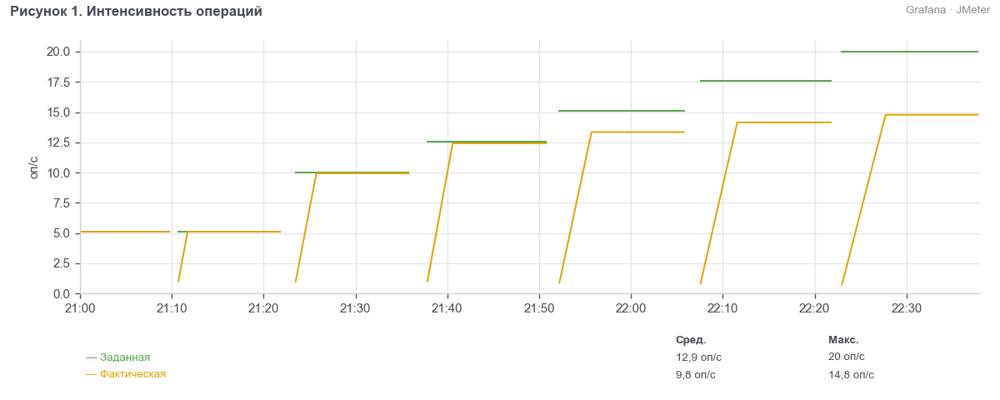
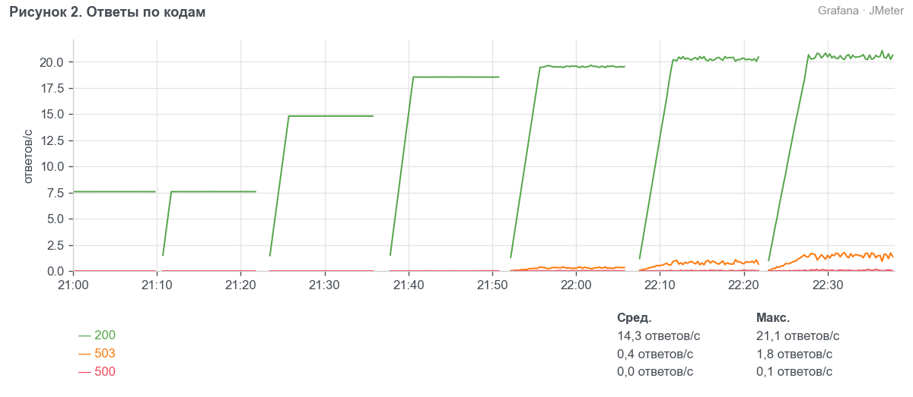
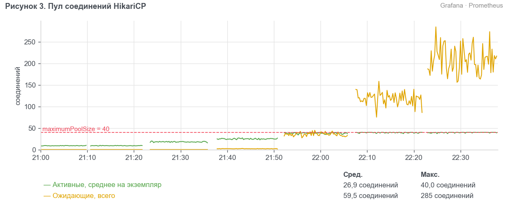
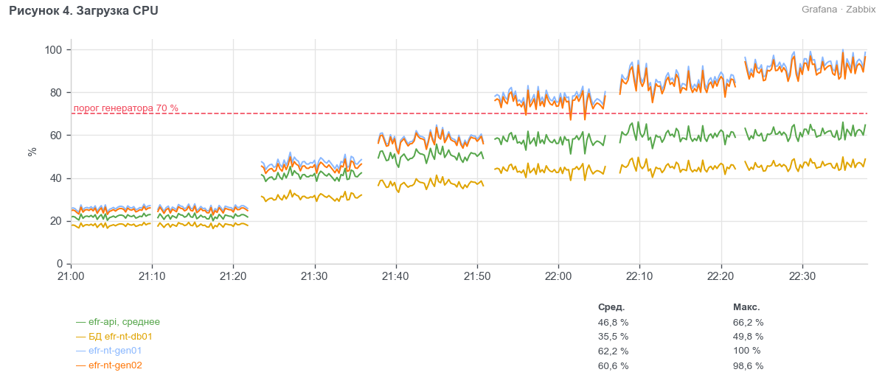
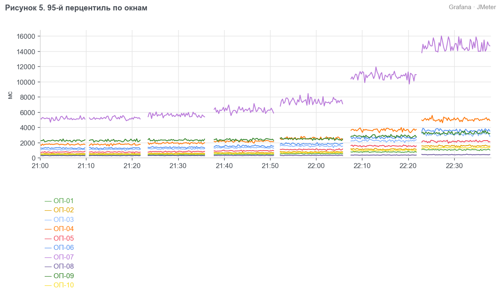
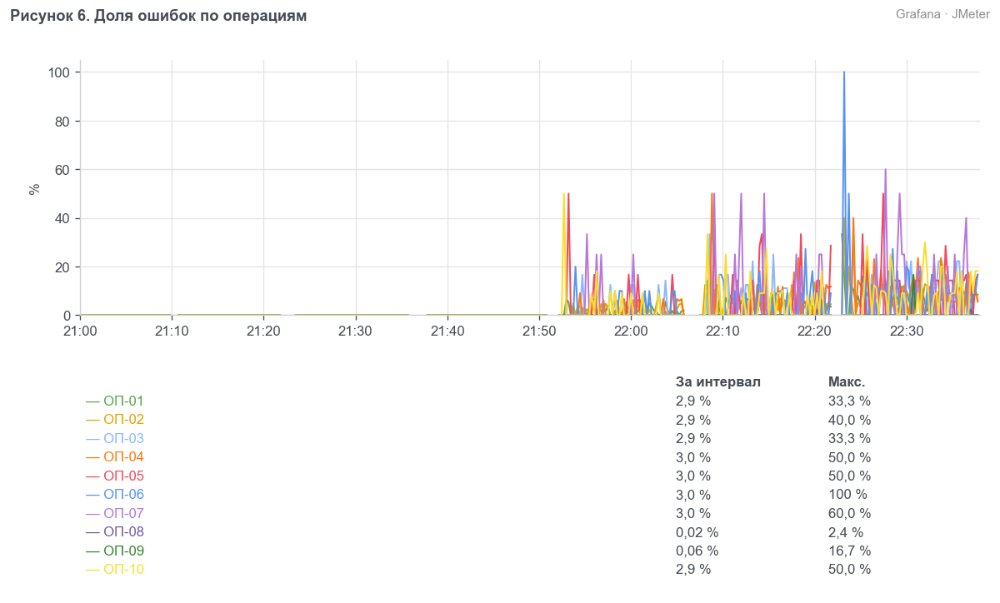
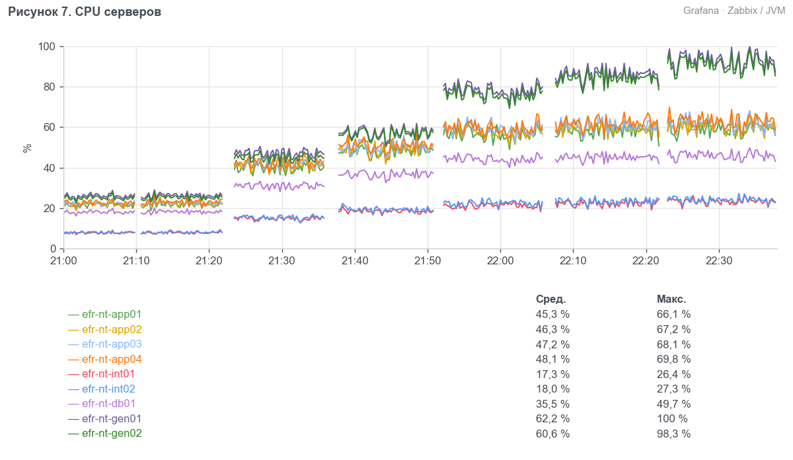
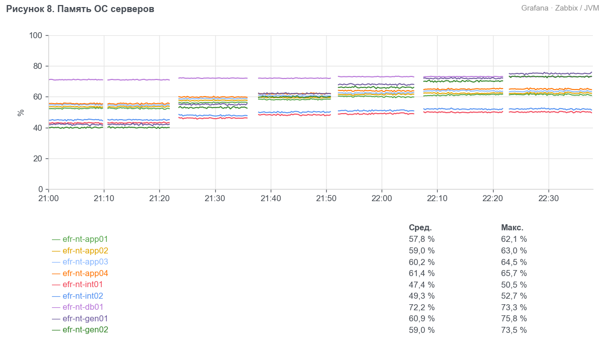
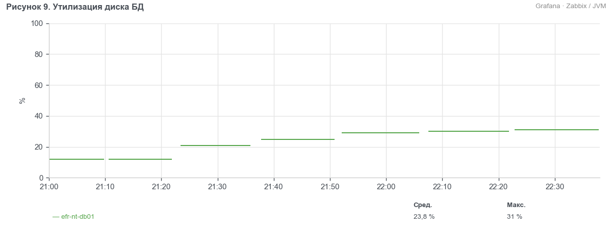
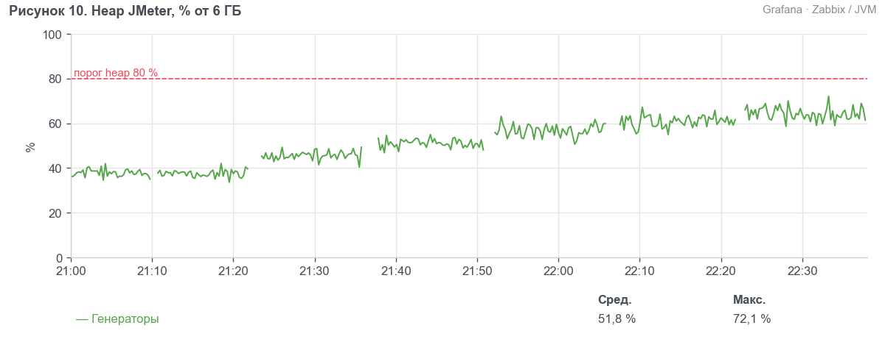

> УТВЕРЖДАЮ
> Руководитель ЦК НТ
> ________________ Д. С. Ермаков
> «___» ноября 2026 г.

# Протокол нагрузочного тестирования системы ЕФР релиза 2026.11 (BIQ-91740)

## 1. Сроки
С 03.11.2026 (установка сборки на контур EFR-NT) по 06.11.2026.

## 2. Участники
- Гусев Павел Андреевич — ведущий инженер ЦК НТ, Блок ИТ
- Сорокина Мария Олеговна — инженер ЦК НТ, Блок ИТ

## 3. Основание
Методика нагрузочного тестирования ЕФР релиза 2026.11 от 02.10.2026. Вид тестирования — поиск максимума.

## 4. BIQ и наименование БИ
BIQ-91740 «ЕФР: открытие вкладов с подтверждением контролёром и выписка за 12 месяцев».

## 5. Тестируемые системы
- ЕФР: efr-api
- ЕФР: efr-cft-adapter

## 6. Неизменяемые системы окружения
- АБС «ЦФТ-Банк», контур CFTNT (ЦФТ 25.5, СП 2.66.91-01)
- fm-check, заглушка (версия 1.4.0)
- СМЭВ, заглушка (версия 2.1.3)
- PostgreSQL 15.8, Kafka 3.7.1

## 7. Сервер
Контур EFR-NT: efr-nt-app01–04, efr-nt-int01–02, efr-nt-db01. Генераторы нагрузки efr-nt-gen01–02.

## 8. Заключение
Проведено тестирование поиска максимума ЕФР релиза 2026.11. Максимальная производительность — 150 % профиля: 228 потоков, 54 480 операций в час. Деградация против эталона в этом тесте не оценивается. Доля ошибок на всех ступенях до 150 % включительно не превышает 1 %. Узкое место — CPU сервера БД. Релиз можно передавать в пром с замечаниями (раздел 9).

## 9. Замечания
- EFR-NT-405. При нагрузке выше 150 % профиля растёт время отклика всех операций, причина — нехватка CPU сервера БД. Статус: открыт, принято решение идти с ним в пром.

## 10. Ограничения
- fm-check и СМЭВ — заглушки с задержками по п. 6.4 методики (п. 6.2).

## 11. Журнал тестирования
- Поиск максимума 2026-11-05 21:00–22:38: прогрев 21:00–21:10 на 50 % профиля, затем шесть ступеней по 10 минут измерения (таблица 1). Перед каждой ступенью — разгон 1 поток в секунду.
- Отчёт о дефектах: EFR-NT-405 (раздел 9).

## 12. Результаты

### 12.1 Поиск максимума
Профиль — по разделу 2 методики. Интенсивность держится пейсингом, ОП-08 — открытая модель. Каждая ступень — отдельный запуск всех десяти сценариев, число потоков — по п. 3.2 с учётом процента ступени. Разгон — 1 поток в секунду, он идёт до начала 10-минутного измерения и в результаты не входит.

Таблица 1. Ступени теста
| Ступень | Измерение, МСК | Потоков | Заданная, оп/ч | Фактическая, оп/ч | Подано, % |
| --- | --- | --- | --- | --- | --- |
| 50 % | 21:12–21:22 | 77 | 18 480 | 18 402 | 99,6 |
| 100 % | 21:26–21:36 | 151 | 36 000 | 35 790 | 99,4 |
| 125 % | 21:41–21:51 | 190 | 45 240 | 44 748 | 98,9 |
| 150 % | 21:56–22:06 | 228 | 54 480 | 48 048 | 88,2 |
| 175 % | 22:12–22:22 | 266 | 63 360 | 50 946 | 80,4 |
| 200 % | 22:28–22:38 | 302 | 72 000 | 53 220 | 73,9 |

Таблица 2. Фактическая интенсивность по операциям, % от заданной
| Операция | 50 % | 100 % | 125 % | 150 % | 175 % | 200 % |
| --- | --- | --- | --- | --- | --- | --- |
| ОП-01 | 99,8 | 99,6 | 98,6 | 87,7 | 79,9 | 74,2 |
| ОП-02 | 99,4 | 99,2 | 98,8 | 88,5 | 80,2 | 73,7 |
| ОП-03 | 100,0 | 99,2 | 99,3 | 87,8 | 80,2 | 74,6 |
| ОП-04 | 99,6 | 99,2 | 98,7 | 87,6 | 80,5 | 73,4 |
| ОП-05 | 100,0 | 100,0 | 99,6 | 88,5 | 80,3 | 73,9 |
| ОП-06 | 99,3 | 99,7 | 98,7 | 88,7 | 80,9 | 74,2 |
| ОП-07 | 100,0 | 100,0 | 99,3 | 87,8 | 80,5 | 73,3 |
| ОП-08 | 99,3 | 99,4 | 99,2 | 88,6 | 81,1 | 74,0 |
| ОП-09 | 99,2 | 99,4 | 100,0 | 88,0 | 81,0 | 73,6 |
| ОП-10 | 100,0 | 99,3 | 99,2 | 88,8 | 80,6 | 73,3 |

Таблица 3. 95-й перцентиль времени операции по ступеням, мс
| Операция | Порог, мс | 50 % | 100 % | 125 % | 150 % | 175 % | 200 % |
| --- | --- | --- | --- | --- | --- | --- | --- |
| ОП-01 | 800 | 380 | 410 | 460 | 540 | 780 | 1 070 |
| ОП-02 | 1 000 | 550 | 600 | 670 | 790 | 1 140 | 1 560 |
| ОП-03 | 2 000 | 1 090 | 1 190 | 1 330 | 1 570 | 2 260 | 3 090 |
| ОП-04 | 3 000 | 1 780 | 1 930 | 2 160 | 2 550 | 3 670 | 5 020 |
| ОП-05 | 1 500 | 760 | 830 | 930 | 1 100 | 1 580 | 2 160 |
| ОП-06 | 2 500 | 1 280 | 1 390 | 1 560 | 1 830 | 2 640 | 3 610 |
| ОП-07 | 8 000 | 5 200 | 5 650 | 6 330 | 7 460 | 10 740 | 14 690 |
| ОП-08 | 600 | 290 | 300 | 310 | 320 | 370 | 420 |
| ОП-09 | 5 000 | 2 270 | 2 320 | 2 390 | 2 510 | 2 840 | 3 250 |
| ОП-10 | 1 200 | 470 | 510 | 570 | 670 | 970 | 1 330 |

Таблица 4. Доля ошибок по операциям, %
| Операция | 50 % | 100 % | 125 % | 150 % | 175 % | 200 % |
| --- | --- | --- | --- | --- | --- | --- |
| ОП-01 | 0,00 | 0,00 | 0,00 | 0,05 | 0,08 | 0,12 |
| ОП-02 | 0,00 | 0,00 | 0,00 | 0,06 | 0,11 | 0,15 |
| ОП-03 | 0,00 | 0,00 | 0,00 | 0,00 | 0,30 | 0,28 |
| ОП-04 | 0,00 | 0,00 | 0,00 | 0,16 | 0,30 | 0,43 |
| ОП-05 | 0,00 | 0,00 | 0,00 | 0,00 | 0,00 | 0,38 |
| ОП-06 | 0,00 | 0,00 | 0,00 | 0,00 | 0,23 | 0,45 |
| ОП-07 | 0,00 | 0,00 | 0,00 | 0,00 | 0,00 | 0,00 |
| ОП-08 | 0,00 | 0,00 | 0,00 | 0,00 | 0,06 | 0,06 |
| ОП-09 | 0,00 | 0,00 | 0,00 | 0,00 | 0,00 | 0,38 |
| ОП-10 | 0,00 | 0,00 | 0,00 | 0,00 | 0,00 | 0,23 |

В таблицу 4 не включены ответы 503: это штатный отказ efr-api при перегрузке, а не ошибка приложения. На 150 % ответом 503 завершились 1,8 % операций через efr-api, на 175 % — 4,5 %, на 200 % — 7,9 % (рисунки 2 и 6).

Таблица 5. Утилизация по ступеням
| Показатель | 50 % | 100 % | 125 % | 150 % | 175 % | 200 % |
| --- | --- | --- | --- | --- | --- | --- |
| CPU efr-api, среднее по 4 серверам, % | 22 | 41 | 50 | 58 | 60 | 61 |
| Память efr-api, среднее по 4 серверам, % | 54 | 58 | 60 | 62 | 63 | 63 |
| CPU efr-cft-adapter, % | 8 | 15 | 19 | 22 | 23 | 24 |
| Память efr-cft-adapter, % | 44 | 47 | 49 | 50 | 51 | 51 |
| CPU БД, % | 18 | 31 | 37 | 44 | 45 | 46 |
| Память БД, % | 71 | 72 | 72 | 73 | 73 | 73 |
| Диск БД, утилизация % | 12 | 21 | 25 | 29 | 30 | 31 |
| CPU efr-nt-gen01, % | 26 | 47 | 58 | 78 | 86 | 93 |
| CPU efr-nt-gen02, % | 25 | 45 | 57 | 76 | 84 | 91 |
| Память efr-nt-gen01, % | 42 | 55 | 62 | 68 | 72 | 75 |
| Память efr-nt-gen02, % | 40 | 53 | 60 | 66 | 70 | 73 |
| Heap JMeter на генераторах, % от 6 ГБ | 38 | 46 | 51 | 57 | 61 | 64 |
| HikariCP: активных на экземпляр (из 40) | 9 | 18 | 25 | 38 | 40 | 40 |
| HikariCP: ожидающих, всего | 0 | 0 | 2 | 35 | 120 | 210 |

В таблице утилизации efr-api и адаптер представлены средними по серверам; разбивка по каждому серверу приведена на графиках CPU и памяти ОС. Память генераторов — утилизация оперативной памяти сервера, heap JMeter показан отдельно. Итоговые p95 и доли ошибок рассчитаны по исходным операциям JTL за указанный в таблице интервал; графики времени отклика показывают оконные p95.

**Вывод.** До 150 % профиля включительно все операции укладываются в пороги p95, доля ошибок не выше 0,16 %. На 175 % превышены пороги ОП-02, ОП-03, ОП-04, ОП-05, ОП-06 и ОП-07. Максимальная производительность — 150 % профиля. Узкое место — CPU сервера БД: на 175 % и 200 % профиля время всех операций растёт, а запросы ждут ответа БД. Рекомендация: увеличить число vCPU сервера БД с 32 до 48.

## 13. Приложения
- Скриншоты дашбордов «ЕФР НТ — JMeter», «ЕФР НТ — efr-api», «ЕФР НТ — серверы».
- Отчёты JMeter по каждой ступени.
- Отчёты PWR за каждую ступень.
- Логи efr-api и БД за 21:00–22:38.
