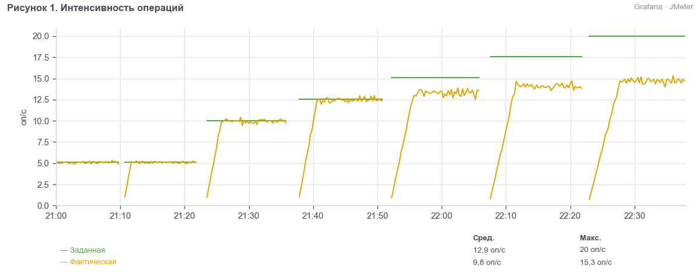
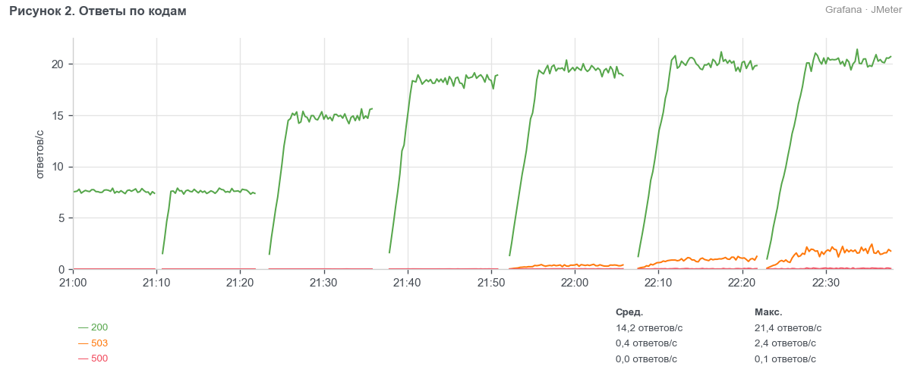
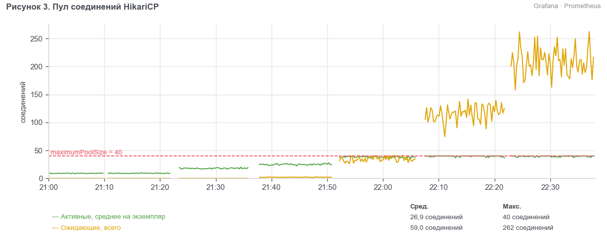
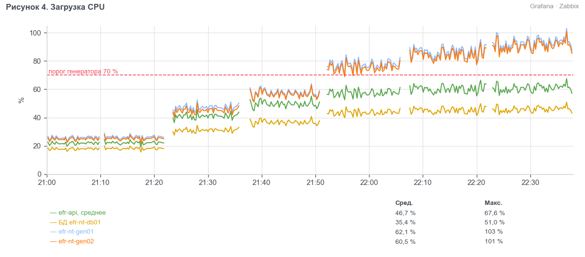

> УТВЕРЖДАЮ
> Руководитель ЦК НТ
> ________________ Д. С. Ермаков
> «___» ноября 2026 г.

# Протокол нагрузочного тестирования системы ЕФР релиза 2026.11 (BIQ-91740)

## 1. Сроки
С 03.11.2026 (установка сборки на контур EFR-NT) по 06.11.2026.

## 2. Участники
- Гусев Павел Андреевич — ведущий инженер ЦК НТ, Блок ИТ
- Сорокина Мария Олеговна — инженер ЦК НТ, Блок ИТ

## 3. Основание
Методика нагрузочного тестирования ЕФР релиза 2026.11 от 02.10.2026. Вид тестирования — поиск максимума.

## 4. BIQ и наименование БИ
BIQ-91740 «ЕФР: открытие вкладов с подтверждением контролёром и выписка за 12 месяцев».

## 5. Тестируемые системы
- ЕФР: efr-api
- ЕФР: efr-cft-adapter

## 6. Неизменяемые системы окружения
- АБС «ЦФТ-Банк», контур CFTNT (ЦФТ 25.5, СП 2.66.91-01)
- fm-check, заглушка (версия 1.4.0)
- СМЭВ, заглушка (версия 2.1.3)
- PostgreSQL 15.8, Kafka 3.7.1

## 7. Сервер
Контур EFR-NT: efr-nt-app01–04, efr-nt-int01–02, efr-nt-db01. Генераторы нагрузки efr-nt-gen01–02.

## 8. Заключение
Проведено тестирование поиска максимума ЕФР релиза 2026.11. Максимальная производительность — 150 % профиля: 228 потоков, 54 480 операций в час. Деградация против эталона в этом тесте не оценивается. Доля ошибок на всех ступенях до 150 % включительно не превышает 1 %. Узкое место — CPU сервера БД. Релиз можно передавать в пром с замечаниями (раздел 9).

## 9. Замечания
- EFR-NT-405. При нагрузке выше 150 % профиля растёт время отклика всех операций, причина — нехватка CPU сервера БД. Статус: открыт, принято решение идти с ним в пром.

## 10. Ограничения
- fm-check и СМЭВ — заглушки с задержками по п. 6.4 методики (п. 6.2).

## 11. Журнал тестирования
- Поиск максимума 2026-11-05 21:00–22:38: прогрев 21:00–21:10 на 50 % профиля, затем шесть ступеней по 10 минут измерения (таблица 1). Перед каждой ступенью — разгон 1 поток в секунду.
- Отчёт о дефектах: EFR-NT-405 (раздел 9).

## 12. Результаты

### 12.1 Поиск максимума
Профиль — по разделу 2 методики. Интенсивность держится пейсингом, ОП-08 — открытая модель. Каждая ступень — отдельный запуск всех десяти сценариев, число потоков — по п. 3.2 с учётом процента ступени. Разгон — 1 поток в секунду, он идёт до начала 10-минутного измерения и в результаты не входит.

Таблица 1. Ступени теста
| Ступень | Измерение, МСК | Потоков | Заданная, оп/ч | Фактическая, оп/ч | Подано, % |
| --- | --- | --- | --- | --- | --- |
| 50 % | 21:12–21:22 | 77 | 18 480 | 18 406 | 99,6 |
| 100 % | 21:26–21:36 | 151 | 36 000 | 35 784 | 99,4 |
| 125 % | 21:41–21:51 | 190 | 45 240 | 44 742 | 98,9 |
| 150 % | 21:56–22:06 | 228 | 54 480 | 48 051 | 88,2 |
| 175 % | 22:12–22:22 | 266 | 63 360 | 50 941 | 80,4 |
| 200 % | 22:28–22:38 | 302 | 72 000 | 53 208 | 73,9 |

Таблица 2. Фактическая интенсивность по операциям, % от заданной
| Операция | 50 % | 100 % | 125 % | 150 % | 175 % | 200 % |
| --- | --- | --- | --- | --- | --- | --- |
| ОП-01 | 99,3 | 99,0 | 99,0 | 88,1 | 79,7 | 73,6 |
| ОП-02 | 100,0 | 99,4 | 99,5 | 87,8 | 81,3 | 74,9 |
| ОП-03 | 99,1 | 98,9 | 98,5 | 88,4 | 79,9 | 73,6 |
| ОП-04 | 98,9 | 99,2 | 99,4 | 89,3 | 81,2 | 74,2 |
| ОП-05 | 99,2 | 99,9 | 98,3 | 88,5 | 82,3 | 73,9 |
| ОП-06 | 98,3 | 99,2 | 99,1 | 88,4 | 80,3 | 75,1 |
| ОП-07 | 99,7 | 99,5 | 98,4 | 88,8 | 80,6 | 74,9 |
| ОП-08 | 98,5 | 99,7 | 100,0 | 89,0 | 81,1 | 73,1 |
| ОП-09 | 99,6 | 98,6 | 98,9 | 88,2 | 80,3 | 72,9 |
| ОП-10 | 98,6 | 99,4 | 98,9 | 88,1 | 80,1 | 73,8 |

Таблица 3. 95-й перцентиль времени операции по ступеням, мс
| Операция | Порог, мс | 50 % | 100 % | 125 % | 150 % | 175 % | 200 % |
| --- | --- | --- | --- | --- | --- | --- | --- |
| ОП-01 | 800 | 390 | 420 | 470 | 550 | 800 | 1 090 |
| ОП-02 | 1 000 | 560 | 610 | 680 | 810 | 1 160 | 1 590 |
| ОП-03 | 2 000 | 1 090 | 1 180 | 1 320 | 1 560 | 2 240 | 3 070 |
| ОП-04 | 3 000 | 1 790 | 1 950 | 2 180 | 2 570 | 3 700 | 5 070 |
| ОП-05 | 1 500 | 750 | 820 | 920 | 1 080 | 1 560 | 2 130 |
| ОП-06 | 2 500 | 1 290 | 1 400 | 1 570 | 1 850 | 2 660 | 3 640 |
| ОП-07 | 8 000 | 5 150 | 5 600 | 6 270 | 7 390 | 10 640 | 14 560 |
| ОП-08 | 600 | 290 | 310 | 350 | 410 | 590 | 810 |
| ОП-09 | 5 000 | 2 120 | 2 300 | 2 580 | 3 040 | 4 370 | 5 980 |
| ОП-10 | 1 200 | 480 | 520 | 580 | 690 | 990 | 1 350 |

Таблица 4. Доля ошибок по операциям, %
| Операция | 50 % | 100 % | 125 % | 150 % | 175 % | 200 % |
| --- | --- | --- | --- | --- | --- | --- |
| ОП-01 | 0,01 | 0,01 | 0,02 | 0,04 | 0,07 | 0,14 |
| ОП-02 | 0,01 | 0,02 | 0,02 | 0,05 | 0,09 | 0,16 |
| ОП-03 | 0,03 | 0,04 | 0,06 | 0,11 | 0,21 | 0,38 |
| ОП-04 | 0,04 | 0,05 | 0,07 | 0,14 | 0,27 | 0,49 |
| ОП-05 | 0,02 | 0,04 | 0,05 | 0,10 | 0,18 | 0,32 |
| ОП-06 | 0,03 | 0,04 | 0,06 | 0,12 | 0,22 | 0,41 |
| ОП-07 | 0,02 | 0,02 | 0,03 | 0,06 | 0,12 | 0,22 |
| ОП-08 | 0,01 | 0,01 | 0,01 | 0,02 | 0,04 | 0,08 |
| ОП-09 | 0,02 | 0,03 | 0,04 | 0,07 | 0,14 | 0,24 |
| ОП-10 | 0,01 | 0,02 | 0,02 | 0,05 | 0,09 | 0,16 |

В таблицу 4 не включены ответы 503: это штатный отказ efr-api при перегрузке, а не ошибка приложения. На 150 % их 1,8 % запросов, на 175 % — 4,5 %, на 200 % — 7,9 % (рисунок 2).

Таблица 5. Утилизация по ступеням
| Показатель | 50 % | 100 % | 125 % | 150 % | 175 % | 200 % |
| --- | --- | --- | --- | --- | --- | --- |
| CPU efr-api, среднее по 4 серверам, % | 22 | 41 | 50 | 58 | 60 | 61 |
| Память efr-api, среднее по 4 серверам, % | 54 | 58 | 60 | 62 | 63 | 63 |
| CPU efr-cft-adapter, % | 8 | 15 | 19 | 22 | 23 | 24 |
| Память efr-cft-adapter, % | 44 | 47 | 49 | 50 | 51 | 51 |
| CPU БД, % | 18 | 31 | 37 | 44 | 45 | 46 |
| Память БД, % | 71 | 72 | 72 | 73 | 73 | 73 |
| Диск БД, утилизация % | 12 | 21 | 25 | 29 | 30 | 31 |
| CPU efr-nt-gen01, % | 26 | 47 | 58 | 78 | 86 | 93 |
| CPU efr-nt-gen02, % | 25 | 45 | 57 | 76 | 84 | 91 |
| HikariCP: активных на экземпляр (из 40) | 9 | 18 | 25 | 38 | 40 | 40 |
| Heap JMeter на генераторах, % от 6 ГБ | 38 | 46 | 51 | 57 | 61 | 64 |
| HikariCP: ожидающих, всего | 0 | 0 | 2 | 35 | 120 | 210 |

**Вывод.** До 150 % профиля включительно все операции укладываются в пороги p95, доля ошибок не выше 0,14 %. На 175 % превышены пороги ОП-02, ОП-03, ОП-04, ОП-05, ОП-06 и ОП-07. Максимальная производительность — 150 % профиля. Узкое место — CPU сервера БД: на 175 % и 200 % профиля время всех операций растёт, а запросы ждут ответа БД. Рекомендация: увеличить число vCPU сервера БД с 32 до 48.

## 13. Приложения
- Скриншоты дашбордов «ЕФР НТ — JMeter», «ЕФР НТ — efr-api», «ЕФР НТ — серверы».
- Отчёты JMeter по каждой ступени.
- Отчёты PWR за каждую ступень.
- Логи efr-api и БД за 21:00–22:38.
