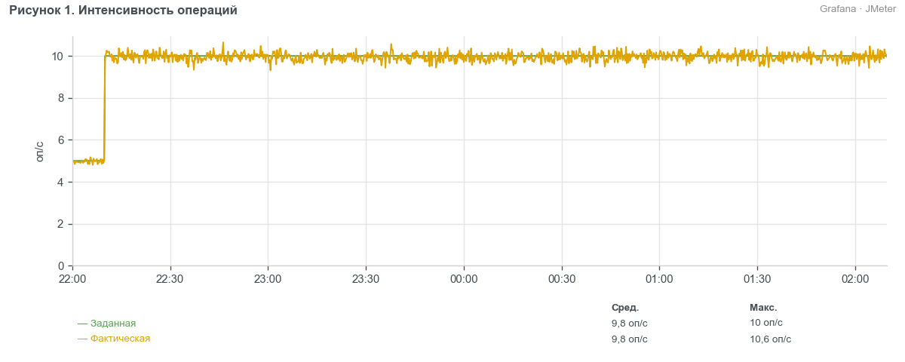
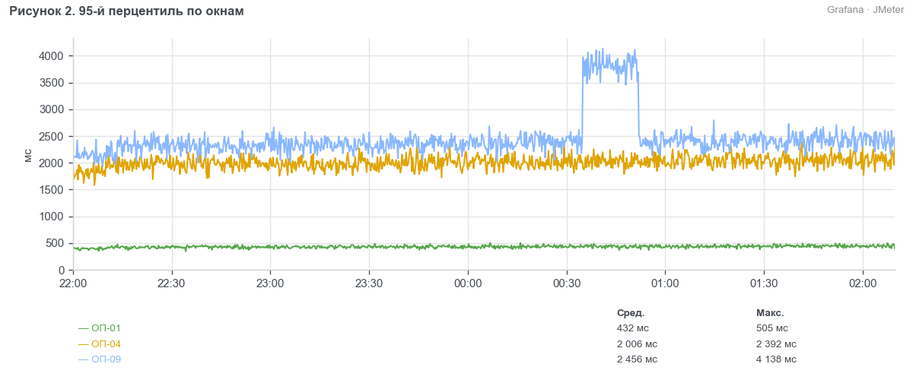
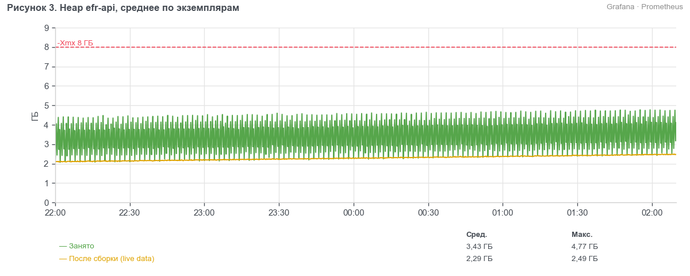
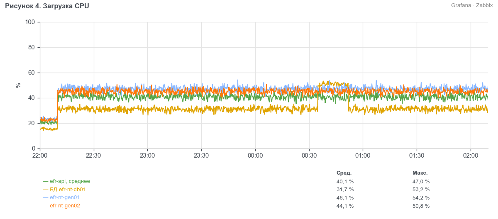

> УТВЕРЖДАЮ
> Руководитель ЦК НТ
> ________________ Д. С. Ермаков
> «___» ноября 2026 г.

# Протокол нагрузочного тестирования системы ЕФР релиза 2026.11 (BIQ-91740)

## 1. Сроки
С 03.11.2026 (установка сборки на контур EFR-NT) по 09.11.2026.

## 2. Участники
- Сорокина Мария Олеговна — инженер ЦК НТ, Блок ИТ
- Гусев Павел Андреевич — ведущий инженер ЦК НТ, Блок ИТ

## 3. Основание
Методика нагрузочного тестирования ЕФР релиза 2026.11 от 02.10.2026. Вид тестирования — стабильность.

## 4. BIQ и наименование БИ
BIQ-91740 «ЕФР: открытие вкладов с подтверждением контролёром и выписка за 12 месяцев».

## 5. Тестируемые системы
- ЕФР efr-api 2026.11.0 (сборка 2026.11.0-b412)
- ЕФР efr-cft-adapter 3.8.2

## 6. Неизменяемые системы окружения
- АБС «ЦФТ-Банк», контур CFTNT (ЦФТ 25.5, СП 2.66.91-01)
- fm-check, заглушка (версия 1.4.0)
- СМЭВ, заглушка (версия 2.1.3)
- PostgreSQL 15.8, Kafka 3.7.1

## 7. Сервер
Контур EFR-NT: efr-nt-app01–04, efr-nt-int01–02, efr-nt-db01. Генераторы нагрузки efr-nt-gen01–02.

## 8. Заключение
Проведено тестирование стабильности ЕФР релиза 2026.11: 4 часа на 100 % профиля. Все операции укладываются в пороги p95, доля ошибок не выше 0,05 %. Утечек памяти не выявлено, деградации времени отклика за время теста нет. Релиз можно передавать в пром без замечаний.

## 9. Замечания
- EFR-NT-411. ОП-07: выписка по счёту, у которого больше 300 000 проводок за год, единично превышает таймаут 60 с. Статус: открыт, исправление запланировано в 2026.12.

## 10. Ограничения
- fm-check и СМЭВ — заглушки с задержками по п. 6.4 методики (п. 6.2).

## 11. Журнал тестирования
- Тестирование стабильности 2026-11-06 22:00 — 2026-11-07 02:10: прогрев 22:00–22:10 на 50 % профиля, далее 100 % профиля.
- 00:35–00:52 — выполнен VACUUM (ANALYZE) operations: по мониторингу выросло число мёртвых строк в таблице.
- Отчёт о дефектах: EFR-NT-411 (раздел 9).

## 12. Результаты

### 12.1 Стабильность
Профиль — по разделу 2 методики, все десять операций. Интенсивность держится пейсингом, ОП-08 — открытая модель.

Таблица 1. Бизнес-метрики за интервал 22:00–02:10
| Операция | Заданная, оп/ч | Фактическая, оп/ч | p95, мс | Порог, мс | Ошибки, % |
| --- | --- | --- | --- | --- | --- |
| ОП-01 | 10 080 | 9 839 | 470 | 800 | 0,01 |
| ОП-02 | 7 920 | 7 731 | 680 | 1 000 | 0,01 |
| ОП-03 | 1 440 | 1 406 | 1 320 | 2 000 | 0,04 |
| ОП-04 | 2 880 | 2 811 | 2 190 | 3 000 | 0,05 |
| ОП-05 | 1 080 | 1 054 | 920 | 1 500 | 0,03 |
| ОП-06 | 1 800 | 1 757 | 1 570 | 2 500 | 0,04 |
| ОП-07 | 720 | 703 | 6 250 | 8 000 | 0,02 |
| ОП-08 | 7 200 | 7 028 | 350 | 600 | 0,01 |
| ОП-09 | 1 080 | 1 054 | 3 710 | 5 000 | 0,03 |
| ОП-10 | 1 800 | 1 757 | 580 | 1 200 | 0,01 |

Таблица 2. Утилизация за интервал 22:00–02:10
| Показатель | Среднее | Максимум |
| --- | --- | --- |
| CPU efr-api, среднее по 4 серверам, % | 40 | 47 |
| Память efr-api, среднее по 4 серверам, % | 59 | 63 |
| CPU efr-cft-adapter, % | 15 | 18 |
| Память efr-cft-adapter, % | 47 | 50 |
| CPU БД, % | 32 | 53 |
| Память БД, % | 72 | 75 |
| Диск БД, утилизация % | 24 | 66 |
| CPU efr-nt-gen01, % | 46 | 54 |
| CPU efr-nt-gen02, % | 44 | 51 |
| Heap JMeter на генераторах, % от 6 ГБ | 46 | 53 |

**Вывод.** За весь тест время отклика всех операций стабильно и ниже порогов, интенсивность подана. Занятый heap efr-api колеблется в пределах 2–5 ГБ при максимуме 8 ГБ и после сборок мусора возвращается к 2–2,5 ГБ: утечки памяти нет. Кратковременный рост времени ОП-09 и CPU БД в 00:35–00:52 связан с вакуумом таблицы operations и на итог не влияет.

## 13. Приложения
- Скриншоты дашбордов «ЕФР НТ — JMeter», «ЕФР НТ — efr-api», «ЕФР НТ — серверы».
- Отчёт JMeter за 22:00–02:10.
- Отчёт PWR за 22:00–02:10.
- Логи efr-api и БД за время теста.
