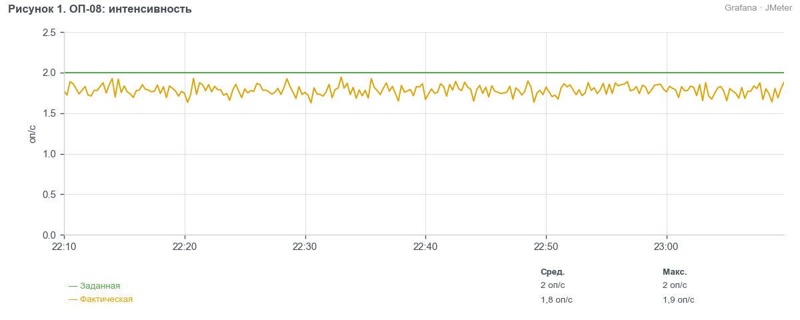
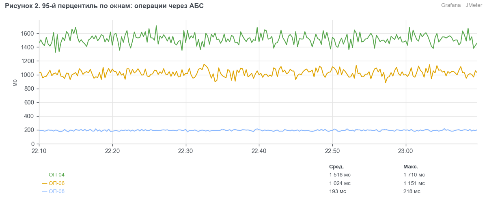

> УТВЕРЖДАЮ
> Руководитель ЦК НТ
> ________________ Д. С. Ермаков
> «___» ноября 2026 г.

# Протокол нагрузочного тестирования системы ЕФР релиза 2026.11 hotfix 1 (BIQ-91802)

## 1. Сроки
С 18.11.2026 (установка efr-cft-adapter 3.8.3 на контур EFR-NT) по 20.11.2026.

## 2. Участники
- Гусев Павел Андреевич — ведущий инженер ЦК НТ, Блок ИТ
- Сорокина Мария Олеговна — инженер ЦК НТ, Блок ИТ

## 3. Основание
Методика нагрузочного тестирования ЕФР релиза 2026.11 от 02.10.2026. Вид тестирования — сравнение с эталоном.

## 4. BIQ и наименование БИ
BIQ-91802 «ЕФР: исправление повторной отправки запроса остатка в АБС».

## 5. Тестируемые системы
- ЕФР efr-cft-adapter 3.8.3 (hotfix)

## 6. Неизменяемые системы окружения
- ЕФР efr-api 2026.11.0 (сборка 2026.11.0-b431)
- АБС «ЦФТ-Банк» — заглушка АБС (версия 0.9.4)
- fm-check, заглушка (версия 1.4.0)
- СМЭВ, заглушка (версия 2.1.3)
- PostgreSQL 15.8, Kafka 3.7.1

## 7. Сервер
Контур EFR-NT: efr-nt-app01–04, efr-nt-int01–02, efr-nt-db01. Генераторы нагрузки efr-nt-gen01–02.

## 8. Заключение
Проведено сравнение efr-cft-adapter 3.8.3 с эталоном — версией 3.8.2. Деградации нет: время операций, которые идут в АБС, уменьшилось на 20–35 %. Доля ошибок не превышает 1 %.

## 9. Замечания
Нет.

## 10. Ограничения
- АБС «ЦФТ-Банк» — заглушка АБС: контур CFTNT недоступен 17–21.11.2026 из-за работ на контуре (п. 6.2 методики).
- fm-check и СМЭВ — заглушки (п. 6.2).

## 11. Журнал тестирования
- Сравнение с эталоном 2026-11-19 22:00–23:10: прогрев 22:00–22:10 на 50 % профиля, измерение 22:10–23:10 на 100 % профиля.
- Эталон: замер версии 3.8.2 от 16.11.2026 на CFTNT, efr-api сборки b431, 1 ч на 100 % профиля.
- Отчёт о дефектах: дефектов нет.

## 12. Результаты

### 12.1 Сравнение с эталоном
Профиль — по разделу 2 методики, все десять операций. Интенсивность держится пейсингом, ОП-08 — открытая модель.

Таблица 1. Условия теста и эталона
| Параметр | Эталон | Тест |
| --- | --- | --- |
| Версия efr-cft-adapter | 3.8.2 | 3.8.3 (hotfix) |
| Дата | 16.11.2026 | 19.11.2026 |
| АБС «ЦФТ-Банк» | контур CFTNT | заглушка АБС |
| Строк в operations | 421 млн | 422 млн |
| Нагрузка, длительность | 100 % профиля, 1 ч | 100 % профиля, 1 ч |

Таблица 2. Задержки заглушек в тесте
| Заглушка | Метод | Задержка, мс |
| --- | --- | --- |
| АБС «ЦФТ-Банк» | GetAccountBalance | 0 |
| АБС «ЦФТ-Банк» | OpenDeposit, CloseDeposit | 0 |
| fm-check | check | 200 |
| СМЭВ | проверка паспорта | 300 |

Таблица 3. Бизнес-метрики теста, 22:10–23:10
| Операция | Заданная, оп/ч | Фактическая, оп/ч | p95, мс | Порог, мс | Ошибки, % | Таймауты, шт. |
| --- | --- | --- | --- | --- | --- | --- |
| ОП-01 | 10 080 | 10 040 | 421 | 800 | 0,01 | 0 |
| ОП-02 | 7 920 | 7 888 | 611 | 1 000 | 0,02 | 0 |
| ОП-03 | 1 440 | 1 434 | 1 182 | 2 000 | 0,04 | 0 |
| ОП-04 | 2 880 | 2 868 | 1 560 | 3 000 | 0,05 | 0 |
| ОП-05 | 1 080 | 1 076 | 818 | 1 500 | 0,03 | 0 |
| ОП-06 | 1 800 | 1 793 | 1 060 | 2 500 | 0,04 | 0 |
| ОП-07 | 720 | 717 | 5 610 | 8 000 | 0,02 | 0 |
| ОП-08 | 7 200 | 6 400 | 200 | 800 | 0,60 | 38 |
| ОП-09 | 1 080 | 1 076 | 2 310 | 5 000 | 0,03 | 0 |
| ОП-10 | 1 800 | 1 793 | 522 | 1 200 | 0,01 | 0 |

Таймауты ОП-08 — особенность заглушки АБС, в долю ошибок они не включены.

Таблица 4. 95-й перцентиль против эталона, мс
| Операция | Эталон 3.8.2 | Тест 3.8.3 | Изменение, % |
| --- | --- | --- | --- |
| ОП-01 | 418 | 421 | 0,7 |
| ОП-02 | 605 | 611 | 1,0 |
| ОП-03 | 1 175 | 1 182 | 0,6 |
| ОП-04 | 1 940 | 1 560 | −19,6 |
| ОП-05 | 815 | 818 | 0,4 |
| ОП-06 | 1 395 | 1 060 | −24,0 |
| ОП-07 | 5 580 | 5 610 | 0,5 |
| ОП-08 | 310 | 200 | −35,5 |
| ОП-09 | 2 290 | 2 310 | 0,9 |
| ОП-10 | 518 | 522 | 0,8 |

Таблица 5. Утилизация против эталона, среднее за тест
| Показатель | Эталон | Тест | Изменение, % |
| --- | --- | --- | --- |
| CPU efr-api, среднее по 4 серверам, % | 41 | 40 | −2,4 |
| Память efr-api, среднее по 4 серверам, % | 59 | 59 | 0,0 |
| CPU efr-cft-adapter, % | 15 | 12 | −20,0 |
| Память efr-cft-adapter, % | 52 | 51 | −1,9 |
| CPU БД, % | 31 | 31 | 0,0 |
| Память БД, % | 72 | 72 | 0,0 |
| Диск БД, утилизация % | 21 | 21 | 0,0 |
| CPU efr-nt-gen01, % | 47 | 47 | 0,0 |
| CPU efr-nt-gen02, % | 45 | 45 | 0,0 |
| Heap JMeter на генераторах, % от 6 ГБ | 46 | 46 | 0,0 |

**Вывод.** Нагрузка подана полностью, все операции в пределах порогов. Hotfix 3.8.3 ускорил операции через АБС: ОП-08 — на 35 %, ОП-06 — на 24 %, ОП-04 — на 20 %. CPU efr-cft-adapter снизился на 20 %. Доля ошибок ОП-08 — 0,6 %, в пределах 1 %.

## 13. Приложения
- Скриншоты дашбордов «ЕФР НТ — JMeter», «ЕФР НТ — efr-api», «ЕФР НТ — серверы».
- Отчёт JMeter и отчёт PWR за 22:10–23:10.
- Логи efr-api, efr-cft-adapter и БД за 22:10–23:10.
