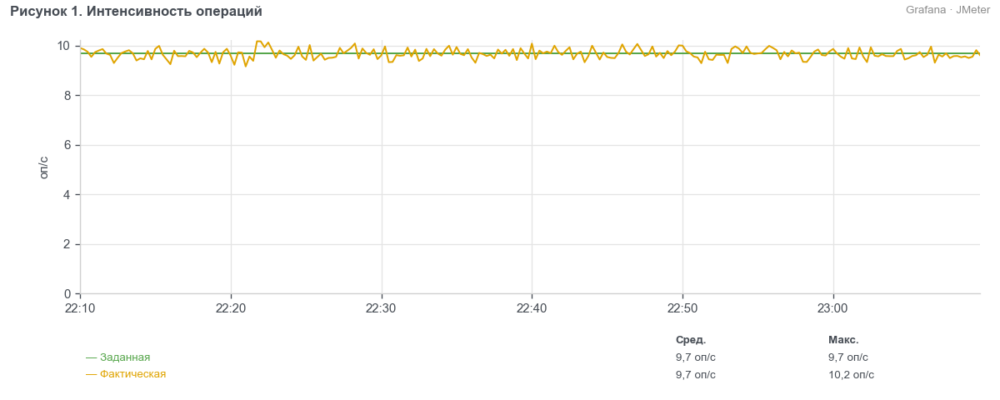
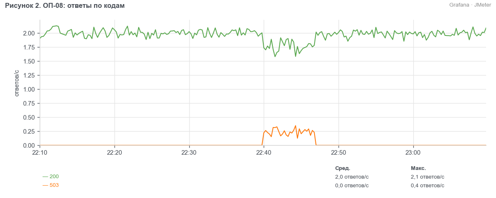
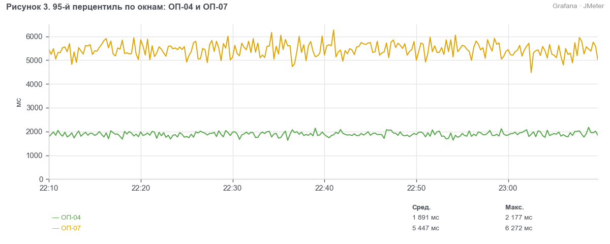

> УТВЕРЖДАЮ
> Руководитель ЦК НТ
> ________________ Д. С. Ермаков
> «___» ноября 2026 г.

# Протокол нагрузочного тестирования системы ЕФР релиза 2026.11 (BIQ-91740)

## 1. Сроки
С 03.11.2026 (установка сборки на контур EFR-NT) по 10.11.2026.

## 2. Участники
- Гусев Павел Андреевич — ведущий инженер ЦК НТ, Блок ИТ

## 3. Основание
Методика нагрузочного тестирования ЕФР релиза 2026.11 от 02.10.2026. Вид тестирования — сравнение с эталоном.

## 4. BIQ и наименование БИ
BIQ-91740 «ЕФР: открытие вкладов с подтверждением контролёром и выписка за 12 месяцев».

## 5. Тестируемые системы
- ЕФР efr-api 2026.11.0 (сборка 2026.11.0-b412)
- ЕФР efr-cft-adapter 3.8.2

## 6. Неизменяемые системы окружения
- АБС «ЦФТ-Банк», контур CFTNT (ЦФТ 25.5, СП 2.66.91-01)
- fm-check, заглушка (версия 1.4.0)
- СМЭВ, заглушка (версия 2.1.3)
- PostgreSQL 15.8, Kafka 3.7.1

## 7. Сервер
Контур EFR-NT: efr-nt-app01–04, efr-nt-int01–02, efr-nt-db01. Генераторы нагрузки efr-nt-gen01–02.

## 8. Заключение
Проведено сравнение ЕФР релиза 2026.11 с эталоном — релизом 2026.08. Деградации производительности нет: время всех операций в пределах порогов методики, наибольший рост p95 — у ОП-04, 14 %, при пороге 3 000 мс ОП-04 выполняется за 1 950 мс. Ошибок нет. Релиз можно передавать в пром без замечаний.

## 9. Замечания
Нет.

## 10. Ограничения
- fm-check и СМЭВ — заглушки с задержками по п. 6.4 методики (п. 6.2).

## 11. Журнал тестирования
- Сравнение с эталоном 2026-11-07 22:00–23:10: прогрев 22:00–22:10 на 50 % профиля, измерение 22:10–23:10 на 100 % профиля.
- Эталон: тест сравнения релиза 2026.08 от 21.08.2026, протокол НТ ЕФР 2026.08.
- Отчёт о дефектах: дефектов нет.

## 12. Результаты

### 12.1 Сравнение с эталоном
Профиль — по разделу 2 методики. Интенсивность держится пейсингом, ОП-08 — открытая модель. Эталон снят на том же контуре и в той же конфигурации.

Таблица 1. Условия теста и эталона
| Параметр | Эталон | Тест |
| --- | --- | --- |
| Релиз | 2026.08 | 2026.11 |
| Дата теста | 21.08.2026 | 07.11.2026 |
| Контур, конфигурация | EFR-NT, по п. 6.1 методики | EFR-NT, по п. 6.1 методики |
| Строк в operations | 300 млн | 420 млн |
| Строк в clients | 11,9 млн | 12,1 млн |
| Длительность | 1 ч на 100 % профиля | 1 ч на 100 % профиля |

Таблица 2. Бизнес-метрики теста, 22:10–23:10
| Операция | Заданная, оп/ч | Фактическая, оп/ч | p95, мс | Порог, мс | Ошибки, % |
| --- | --- | --- | --- | --- | --- |
| ОП-01 | 10 080 | 10 030 | 420 | 800 | 0,01 |
| ОП-02 | 7 920 | 7 880 | 610 | 1 000 | 0,01 |
| ОП-03 | 1 440 | 1 433 | 1 180 | 2 000 | 0,03 |
| ОП-04 | 2 880 | 2 866 | 1 950 | 3 000 | 0,05 |
| ОП-05 | 1 080 | 1 075 | 820 | 1 500 | 0,02 |
| ОП-06 | 1 800 | 1 791 | 1 400 | 2 500 | 0,04 |
| ОП-07 | 720 | 716 | 5 600 | 8 000 | 0,02 |
| ОП-08 | 7 200 | 7 164 | 310 | 600 | 0,00 |
| ОП-10 | 1 800 | 1 791 | 520 | 1 200 | 0,01 |

Таблица 3. 95-й перцентиль против эталона, мс
| Операция | Эталон 2026.08 | Тест 2026.11 | Изменение, % |
| --- | --- | --- | --- |
| ОП-01 | 412 | 420 | 1,9 |
| ОП-02 | 598 | 610 | 2,0 |
| ОП-03 | 1 160 | 1 180 | 1,7 |
| ОП-04 | 1 710 | 1 950 | 14,0 |
| ОП-05 | 805 | 820 | 1,9 |
| ОП-06 | 1 380 | 1 400 | 1,4 |
| ОП-07 | 5 185 | 5 600 | 8,0 |
| ОП-08 | 305 | 310 | 1,6 |
| ОП-10 | 515 | 520 | 1,0 |

Таблица 4. Утилизация против эталона, среднее за тест
| Показатель | Эталон | Тест | Изменение, % |
| --- | --- | --- | --- |
| CPU efr-api, среднее по 4 серверам, % | 32 | 41 | 28,1 |
| Память efr-api, среднее по 4 серверам, % | 57 | 59 | 3,5 |
| CPU efr-cft-adapter, % | 15 | 15 | 0,0 |
| CPU БД, % | 30 | 31 | 3,3 |
| Память БД, % | 71 | 72 | 1,4 |
| Диск БД, утилизация % | 20 | 21 | 5,0 |
| CPU efr-nt-gen01, % | 46 | 47 | 2,2 |
| CPU efr-nt-gen02, % | 44 | 45 | 2,3 |

**Вывод.** Все операции укладываются в пороги p95 методики, доля ошибок не выше 0,05 %. Время операций выросло против эталона на 1–14 %, все значения ниже порогов, поэтому деградации нет. Утилизация серверов на уровне эталона.

## 13. Приложения
- Скриншоты дашбордов «ЕФР НТ — JMeter», «ЕФР НТ — efr-api», «ЕФР НТ — серверы».
- Отчёт JMeter за 22:10–23:10.
- Отчёт PWR за 22:10–23:10.
- Логи efr-api и БД за 22:10–23:10.
