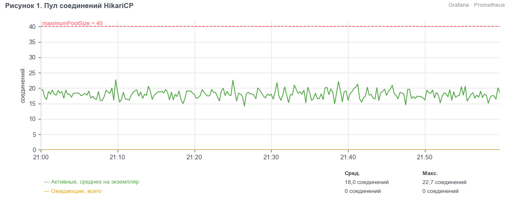
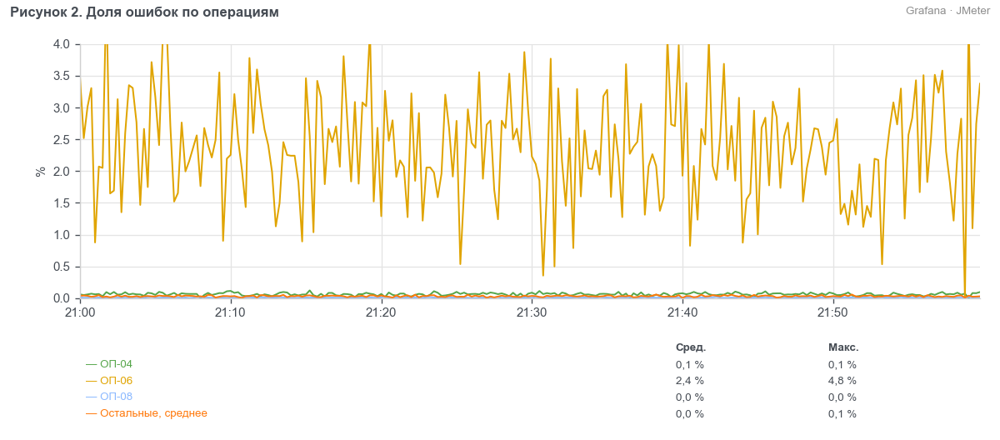
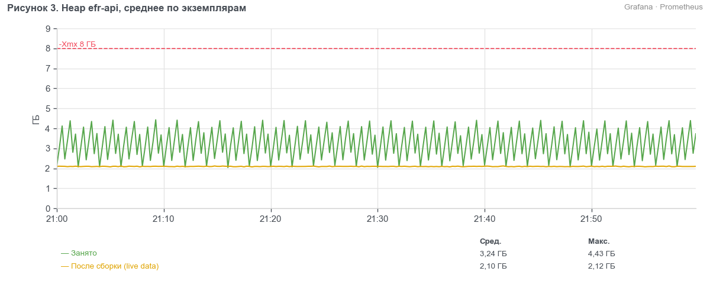

> УТВЕРЖДАЮ
> Руководитель ЦК НТ
> ________________ Д. С. Ермаков
> «___» ноября 2026 г.

# Протокол нагрузочного тестирования системы ЕФР релиза 2026.11 (BIQ-91740)

## 1. Сроки
С 13.11.2026 (установка сборки 2026.11.0-b431 на контур EFR-NT) по 16.11.2026.

## 2. Участники
- Сорокина Мария Олеговна — инженер ЦК НТ, Блок ИТ

## 3. Основание
Методика нагрузочного тестирования ЕФР релиза 2026.11 от 02.10.2026. Вид тестирования — контрольный прогон после исправления дефекта EFR-NT-418.

## 4. BIQ и наименование БИ
BIQ-91740 «ЕФР: открытие вкладов с подтверждением контролёром и выписка за 12 месяцев».

## 5. Тестируемые системы
- ЕФР efr-api 2026.11.0 (сборка 2026.11.0-b431)
- ЕФР efr-cft-adapter 3.8.2

## 6. Неизменяемые системы окружения
- fm-check, заглушка (версия 1.4.0)
- СМЭВ, заглушка (версия 2.1.3)
- PostgreSQL 15.8, Kafka 3.7.1

## 7. Сервер
Контур EFR-NT: efr-nt-app01–04, efr-nt-int01–02, efr-nt-db01. Генераторы нагрузки efr-nt-gen01–02.

## 8. Заключение
Проведён контрольный прогон после исправления дефекта EFR-NT-418 «Соединения HikariCP не возвращаются в пул». Пул соединений стабилен, ожидающих соединений нет — дефект исправлен. Деградации нет, все операции укладываются в пороги p95. Доля ошибок — 0,14 %, в пределах критерия 1 %. Релиз можно передавать в пром без замечаний.

## 9. Замечания
- EFR-NT-418 исправлен в сборке 2026.11.0-b431 и закрыт по результатам контрольного прогона.

## 10. Ограничения
Нет.

## 11. Журнал тестирования
- Стабильность 2026-11-12 (сборка b412, 8 ч): на 5-м часе пул HikariCP исчерпан, заведён EFR-NT-418.
- Контрольный прогон 2026-11-14 22:00–23:00 на 100 % профиля, прогрев 21:50–22:00. Контур CFTNT был занят регламентными работами, АБС подключена через заглушку.
- Отчёт о дефектах: EFR-NT-418 (раздел 9).

## 12. Результаты

### 12.1 Контрольный прогон
Профиль — по разделу 2 методики, все десять операций, 100 % профиля.

Таблица 1. Условия исходного теста и контрольного прогона
| Параметр | Стабильность 12.11.2026 | Контрольный прогон 14.11.2026 |
| --- | --- | --- |
| Сборка efr-api | 2026.11.0-b412 | 2026.11.0-b431 (исправление EFR-NT-418) |
| Вид и длительность | Стабильность, 8 ч | Контрольный прогон, 1 ч |
| Нагрузка | 100 % профиля | 100 % профиля |
| АБС «ЦФТ-Банк» | контур CFTNT | заглушка АБС (CFTNT занят) |
| Пул HikariCP на экземпляр | 40 | 40 |
| Строк в operations | 421 млн | 421 млн |

Таблица 2. Бизнес-метрики контрольного прогона
| Операция | Заданная, оп/ч | Фактическая, оп/ч | p95, мс | Порог, мс |
| --- | --- | --- | --- | --- |
| ОП-01 | 10 080 | 10 040 | 415 | 800 |
| ОП-02 | 7 920 | 7 888 | 600 | 1 000 |
| ОП-03 | 1 440 | 1 434 | 1 170 | 2 000 |
| ОП-04 | 2 880 | 2 868 | 1 570 | 3 000 |
| ОП-05 | 1 080 | 1 076 | 810 | 1 500 |
| ОП-06 | 1 800 | 1 793 | 1 070 | 2 500 |
| ОП-07 | 720 | 717 | 5 550 | 8 000 |
| ОП-08 | 7 200 | 7 171 | 205 | 600 |
| ОП-09 | 1 080 | 1 076 | 2 280 | 5 000 |
| ОП-10 | 1 800 | 1 793 | 515 | 1 200 |
| Ошибки, всего |  |  |  | 0,14 % |

Таблица 3. Утилизация за контрольный прогон
| Показатель | Среднее | Максимум |
| --- | --- | --- |
| CPU efr-api, среднее по 4 серверам, % | 40 | 46 |
| Память efr-api, среднее по 4 серверам, % | 58 | 63 |
| CPU efr-cft-adapter, % | 13 | 16 |
| CPU БД, % | 30 | 36 |
| Память БД, % | 72 | 73 |
| Диск БД, утилизация % | 21 | 27 |
| CPU efr-nt-gen01, % | 46 | 51 |
| CPU efr-nt-gen02, % | 45 | 49 |
| HikariCP: активных на экземпляр (из 40) | 18 | 24 |
| HikariCP: ожидающих, всего | 0 | 0 |

**Вывод.** Активных соединений HikariCP в среднем 18 из 40 на экземпляр, ожидающих нет: соединения возвращаются в пул, EFR-NT-418 исправлен. Время всех операций в пределах порогов. Занятый heap efr-api доходит до 4,8 ГБ — рекомендуем увеличить heap с 8 до 12 ГБ.

## 13. Приложения
- Скриншоты дашбордов «ЕФР НТ — JMeter», «ЕФР НТ — efr-api», «ЕФР НТ — серверы».
- Отчёт JMeter и отчёт PWR за 22:00–23:00.
- Логи efr-api и БД за 22:00–23:00.
