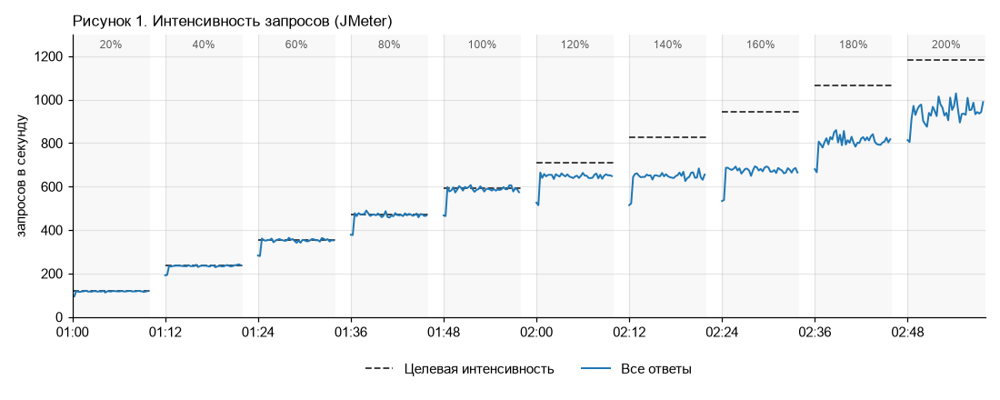
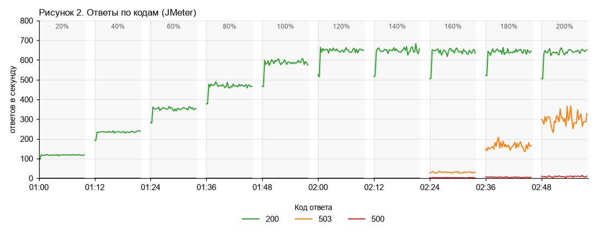
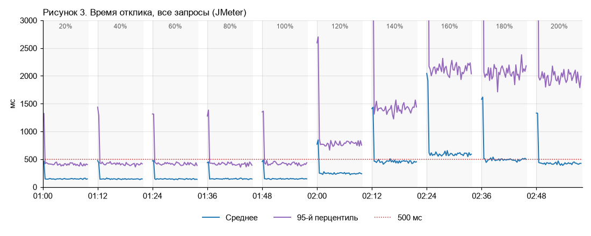
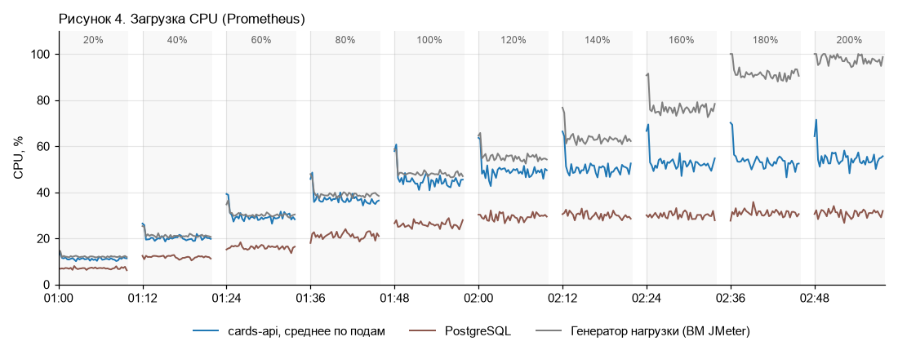
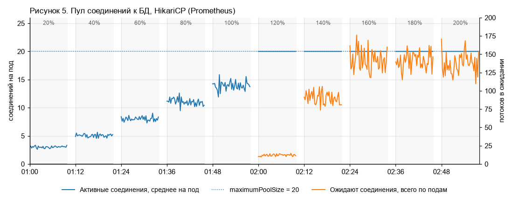
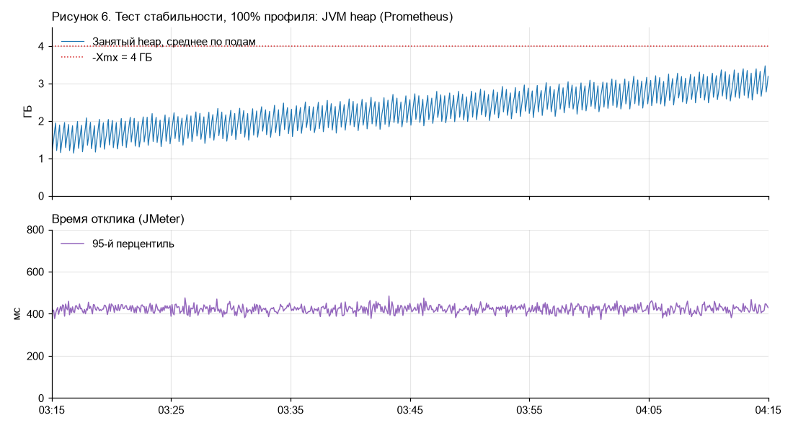

# Отчёт о нагрузочном тестировании cards-api, релиз 3.14

**Дата проведения:** ночь с 15 на 16 сентября 2026 г.
**Стенд:** НТ-2
**Скрипт:** `script/cards-api-load.jmx`, данные — `script/users.csv`

## 1. Цель

В релизе 3.14 история операций по карте переведена со старой таблицы `card_transactions` на новую партиционированную схему `card_operations`. Цель тестирования — подтвердить, что после релиза сервис выполняет нефункциональные требования.

Требования из ТЗ релиза (раздел 5):

- сервис обрабатывает 200 % пиковой нагрузки прода;
- время отклика — не более 500 мс, для реквизитов карты — не более 1 000 мс (запрос уходит в сервис токенизации);
- доля ошибок — не более 1 %.

## 2. Объект тестирования и стенд

`cards-api` — backend мобильного банка для раздела «Карты»: список карт, история операций, лимиты, реквизиты.

**Таблица 1. Стенд и прод**

| Компонент | Прод | Стенд НТ-2 |
| --- | --- | --- |
| cards-api | 6 подов × 4 vCPU / 8 ГБ, heap 4 ГБ | 6 подов × 4 vCPU / 8 ГБ, heap 4 ГБ |
| PostgreSQL | 32 vCPU / 128 ГБ | 32 vCPU / 128 ГБ |
| Redis (кэш списка карт) | 3 узла | 3 узла |
| Карты в БД | 12,4 млн | 40 тыс. |
| Операции в БД | 1,9 млрд строк | 3,2 млн строк |
| Процессинг (изменение лимита) | боевой | заглушка WireMock, ответ без задержки |
| Сервис токенизации (реквизиты) | боевой | тестовый контур |

Объём данных на стенде меньше, чем на проде, но на результаты это не влияет: все запросы сервиса идут по индексам.

Настройки сервиса, существенные для теста:

- пул соединений к БД (HikariCP): `maximumPoolSize = 20` на под, `connectionTimeout = 3 с` — если соединение не освободилось за 3 с, сервис отвечает 500;
- ограничитель одновременных запросов (Resilience4j Bulkhead): не более 65 запросов на под, сверх лимита сервис сразу отвечает 503;
- токен доступа действует 12 часов.

**Генератор нагрузки:** 1 ВМ, 4 vCPU / 8 ГБ, Apache JMeter 5.6.3, запуск в режиме CLI.

**Мониторинг:** Grafana — метрики JMeter из InfluxDB, метрики подов, JVM и HikariCP из Prometheus, метрики PostgreSQL из postgres_exporter. Интервал сбора — 15 с.

## 3. Профиль нагрузки

Профиль построен по статистике прода за пиковый час (приложение А). 100 % профиля — 591 запрос в секунду.

**Таблица 2. Профиль нагрузки**

| Операция | Запрос | Доля | Интенсивность при 100 %, rps |
| --- | --- | --- | --- |
| Список карт | `GET /api/v1/cards` | 50 % | 295 |
| История операций | `GET /api/v1/cards/{id}/transactions` | 15 % | 89 |
| Лимиты | `GET /api/v1/cards/{id}/limits` | 25 % | 148 |
| Изменение лимита | `PUT /api/v1/cards/{id}/limits` | 7 % | 41 |
| Реквизиты | `GET /api/v1/cards/{id}/requisites` | 3 % | 18 |
| **Итого** | | **100 %** | **591** |

## 4. Методика

### 4.1. Тест поиска максимальной производительности

- Ступени от 20 % до 200 % профиля с шагом 20 %.
- Каждая ступень — отдельный запуск длительностью 10 минут, между ступенями пауза 2 минуты. Сервис между ступенями не перезапускался.
- Нагрузка задаётся числом потоков JMeter. На ступени 20 % подобрано 135 потоков, на следующих ступенях число потоков пропорционально ступени. Пауза между запросами — 1 с.
- Разгон — 1 с.
- Результаты ступени — агрегат JMeter за всю ступень.

Критерии успеха ступени:

- среднее время отклика — не более 500 мс (для реквизитов — не более 1 000 мс);
- доля ошибок — не более 1 %.

### 4.2. Тест стабильности

- Нагрузка 100 % профиля (675 потоков), длительность 60 минут. Перед тестом сервис перезапущен.
- Критерии успеха: время отклика и доля ошибок не растут в течение теста, утечек памяти нет.

## 5. Результаты

### 5.1. Поиск максимальной производительности

**Таблица 3. Результаты по ступеням**

| Ступень | Потоков | Целевая интенсивность, rps | Пропускная способность, rps | Среднее время отклика, мс | 95-й перцентиль, мс | Ошибки*, % | Итог |
| --- | --- | --- | --- | --- | --- | --- | --- |
| 20 % | 135 | 118 | 118 | 146 | 415 | 0 | ✅ |
| 40 % | 270 | 236 | 236 | 144 | 412 | 0 | ✅ |
| 60 % | 405 | 355 | 354 | 144 | 414 | 0 | ✅ |
| 80 % | 540 | 473 | 471 | 146 | 418 | 0 | ✅ |
| 100 % | 675 | 591 | 589 | 146 | 424 | 0 | ✅ |
| 120 % | 810 | 709 | 650 | 246 | 790 | 0 | ✅ |
| 140 % | 945 | 827 | 650 | 454 | 1 390 | 0,02 | ✅ |
| 160 % | 1 080 | 946 | 680 | 588 | 2 110 | 0,4 | ❌ |
| 180 % | 1 215 | 1 064 | 814 | 492 | 2 040 | 0,6 | ✅ |
| 200 % | 1 350 | 1 182 | 949 | 423 | 1 960 | 0,9 | ✅ |

\* Без учёта ответов 503 — см. раздел 6.

**Таблица 4. Время отклика по операциям на ступени 100 %**

| Операция | Интенсивность, rps | Среднее, мс | 95-й перцентиль, мс |
| --- | --- | --- | --- |
| Список карт | 294 | 110 | 200 |
| История операций | 88 | 290 | 580 |
| Лимиты | 148 | 100 | 190 |
| Изменение лимита | 41 | 40 | 75 |
| Реквизиты | 18 | 640 | 880 |











### 5.2. Стабильность

За 60 минут на 100 % профиля: пропускная способность 589 rps, среднее время отклика 146 мс, 95-й перцентиль 424 мс, ошибок нет.



## 6. Анализ результатов

- До ступени 100 % включительно все показатели в норме, время отклика стабильно — около 145 мс.
- На ступенях 120–160 % время отклика растёт. На ступени 160 % — кратковременная деградация: среднее время отклика 588 мс.
- На ступенях 180–200 % среднее время отклика снизилось до 423 мс, а пропускная способность выросла до 949 rps: сервис адаптировался к нагрузке (прогрев кэшей и JIT-компиляция).
- С 160 % сервис начинает отвечать 503. Это штатная работа ограничителя одновременных запросов — защита от перегрузки, а не ошибка, поэтому в долю ошибок 503 не включаются (распределение по кодам — в приложении Б).
- Узкое место — CPU подов cards-api: загрузка растёт вместе с нагрузкой и достигает 54 % (рисунок 4).
- Тест стабильности: время отклика стабильно на протяжении всего теста, ошибок нет, утечек памяти не выявлено.

## 7. Выводы и рекомендации

1. Максимальная производительность сервиса — не менее 200 % пиковой нагрузки прода (949 rps). Требование ТЗ выполнено.
2. Сервис стабильно работает на пиковой нагрузке в течение часа.
3. Для запаса по CPU рекомендуется увеличить число подов cards-api с 6 до 10.
4. Релиз 3.14 рекомендуется к выпуску.

## Приложение А. Статистика прода за пиковый час

Пиковый час — 25.08.2026, 10:00–11:00 (день зарплаты).

| Операция | Запросов за час | rps |
| --- | --- | --- |
| Список карт | 1 080 000 | 300 |
| История операций | 756 000 | 210 |
| Лимиты | 216 000 | 60 |
| Изменение лимита | 21 600 | 6 |
| Реквизиты | 54 000 | 15 |
| **Итого** | **2 127 600** | **591** |

Дополнительно за тот же час:

- уникальных пользователей — 184 000;
- время ответа процессинга на изменение лимита — в среднем 180 мс, 95-й перцентиль — 350 мс;
- мобильное приложение прерывает запрос, если ответа нет 10 секунд.

## Приложение Б. Ответы по кодам на ступенях 160–200 %

| Ступень | Код | Интенсивность, rps | Доля, % | Среднее время отклика, мс |
| --- | --- | --- | --- | --- |
| 160 % | 200 | 647,3 | 95,2 | 605 |
| | 503 | 30,0 | 4,4 | 5 |
| | 500 | 2,7 | 0,4 | 3 010 |
| 180 % | 200 | 645,1 | 79,3 | 596 |
| | 503 | 164,0 | 20,1 | 6 |
| | 500 | 4,9 | 0,6 | 3 010 |
| 200 % | 200 | 641,5 | 67,6 | 583 |
| | 503 | 299,0 | 31,5 | 7 |
| | 500 | 8,5 | 0,9 | 3 010 |

## Приложение В. Запуск

Ступень запускалась командой:

```bash
jmeter -n -t cards-api-load.jmx -Jthreads=675 -Jduration=600 -l step-100.jtl
```

`threads` — число потоков ступени (таблица 3), `duration` — длительность в секундах.
